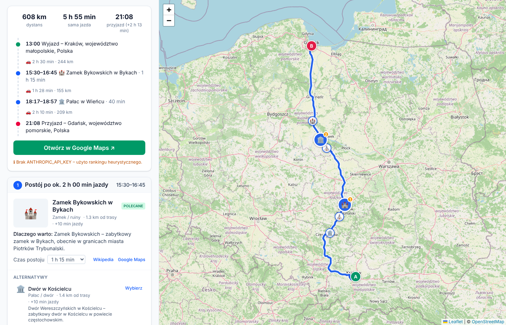

# Po drodze 🚗 → planer postojów

Podajesz start i cel podróży samochodem (np. **Kraków → Gdańsk**), a aplikacja proponuje
ciekawe postoje mniej więcej co 2 godziny jazdy: zamki, punkty widokowe, jeziora, muzea,
kuchnię regionalną oraz – **priorytetowo – MOP-y** (Miejsca Obsługi Podróżnych).



<sub>Zrzut z środowiska testowego bez dostępu do Overpass i Claude API – dlatego widać tylko
miejsca z Wikipedii i ranking heurystyczny (bez MOP-ów).</sub>

## Wersja online

**👉 https://migasmiga67.github.io/whatsonroad/**

Wersja na GitHub Pages działa w całości w przeglądarce: trasę liczy OSRM, geokodowanie robi
Nominatim, miejsca dostarczają Overpass i Wikipedia, a cache trzyma `localStorage`. Ranking AI
jest opcjonalny – w panelu „🤖 Ranking AI (Claude)” można wkleić własny klucz Claude API
(zapisywany tylko w tej przeglądarce i wysyłany wyłącznie do api.anthropic.com). Bez klucza
działa ranking heurystyczny.

Wersja uruchomiona z serwerem (`npm run dev` / `npm start`, np. na Vercel) trzyma klucze
w `.env.local` po stronie serwera i może używać OpenRouteService.

### Publikacja na GitHub Pages

Workflow `.github/workflows/pages.yml` przy każdym pushu na `main` uruchamia testy, buduje
statyczną wersję (`npm run build:static` → katalog `out/`) i publikuje ją. Jednorazowo trzeba
w repozytorium ustawić **Settings → Pages → Build and deployment → Source: „GitHub Actions”**
(zamiast „Deploy from a branch”, które pokazuje tylko README).

## Funkcje

- **Formularz**: start, cel, godzina wyjazdu, odstęp między postojami (suwak 1–3 h, domyślnie 2 h),
  maksymalne zboczenie z trasy (domyślnie 10 km), zainteresowania (przyroda, zabytki, jedzenie,
  dla dzieci, punkty widokowe) i przełącznik **„Priorytet dla MOP-ów”** (domyślnie włączony).
- **Trasa i podział na odcinki** według czasu jazdy. Wokół każdego punktu postoju aplikacja
  przeszukuje fragment trasy ±20–40 min (bufor wzdłuż drogi, nie tylko okrąg).
- **Kandydaci** z OpenStreetMap (Overpass) i Wikipedii (GeoSearch, opisy i zdjęcia).
- **MOP-y**: szukane wąsko przy drodze (`highway=services|rest_area`), z udogodnieniami z OSM
  (paliwo, toalety, jedzenie, plac zabaw, ładowarka EV). Aplikacja liczy, **po której stronie
  jezdni** leży MOP – ten po przeciwnej stronie autostrady jest praktycznie nieosiągalny,
  więc dostaje dużą karę w rankingu.
- **Ranking AI (Claude)**: dla każdego postoju 1 propozycja główna + 2 alternatywy,
  uzasadnienie „dlaczego warto” i szacowany czas zwiedzania. Gdy włączony jest priorytet MOP,
  główną propozycją jest MOP (atrakcje lądują w alternatywach). Bez klucza API działa ranking
  heurystyczny.
- **Mapa** (Leaflet + OpenStreetMap) z trasą, postojami i alternatywami – alternatywę można
  wybrać kliknięciem na mapie lub w karcie postoju; można też pominąć postój i zmienić czas postoju.
- **Oś czasu** z godzinami przyjazdu i wyjazdu – uwzględnia czas postojów i dojazdy do nich.
- **„Otwórz w Google Maps”** – trasa przez wybrane punkty.
- **Cache** odpowiedzi wszystkich API w plikach (`.cache/`), czytelne komunikaty błędów
  i automatyczne przełączanie na zapasowe serwisy.

## Szybki start

```bash
npm install
cp .env.example .env.local   # uzupełnij klucze (patrz niżej)
npm run dev                  # http://localhost:3000
```

Wymagany Node.js ≥ 20.9. Aplikacja działa **nawet bez żadnych kluczy** – wtedy trasę liczy
OSRM, geokodowanie robi Nominatim, a ranking jest heurystyczny.

## Klucze API

### 1. Claude API (ranking AI) – `ANTHROPIC_API_KEY`

1. Załóż konto na <https://platform.claude.com> (Claude Console).
2. Dodaj metodę płatności lub doładuj kredyty (*Settings → Billing*).
3. *Settings → API Keys → Create Key*, skopiuj klucz `sk-ant-…` do `.env.local`.

Domyślny model to `claude-opus-5-5` z `effort: low` (szybko i wystarczająco do wyboru
z listy). Jedno planowanie trasy = jedno zapytanie (wszystkie postoje naraz), a odpowiedzi
trafiają do cache na 7 dni. Model/effort zmienisz przez `CLAUDE_MODEL` i `CLAUDE_EFFORT`.
Włączony jest serwerowy fallback (`fallbacks: "default"`), więc w razie odmowy modelu zapytanie
automatycznie obsłuży model zapasowy.

### 2. OpenRouteService / HeiGIT (trasa + geokodowanie) – `ORS_API_KEY`

> ⚠️ **Zmiana adresu:** od **24.11.2026** stary host `api.openrouteservice.org` zwraca
> `410 Gone`. OpenRouteService działa teraz pod `api.heigit.org` i ma nowe konta.

1. Załóż darmowe konto: <https://account.heigit.org/signup> (dostajesz klucz *Standard*).
2. W *Dashboard* skopiuj klucz do `ORS_API_KEY`.
3. Domyślne adresy (`ORS_BASE_URL`, `ORS_GEOCODE_URL` w `.env.example`) wskazują na nowy host.
   Klucze ze starego panelu openrouteservice.org mogą nie działać na nowej bramce
   (zwraca `403 Access to this API has been disallowed`) – wtedy wygeneruj nowy klucz na
   account.heigit.org.

Dzienne limity darmowego klucza zobaczysz w Dashboard. Gdy ORS jest niedostępny albo
odrzuca klucz, aplikacja (przy `ROUTING_PROVIDER=auto`) sama przełącza się na OSRM/Nominatim.

### 3. API bez klucza

| Serwis | Do czego | Uwagi |
| --- | --- | --- |
| [Overpass API](https://wiki.openstreetmap.org/wiki/Overpass_API) | MOP-y, zamki, jeziora, muzea… z OSM | kilka serwerów w `OVERPASS_URLS`, używane po kolei |
| [Wikipedia GeoSearch](https://www.mediawiki.org/wiki/Extension:GeoData) | opisy i zdjęcia | zapytania szeregowo (polityka Wikimedia) |
| [OSRM](https://project-osrm.org/) | trasa zapasowa | publiczny serwer demo |
| [Nominatim](https://nominatim.org/) | geokodowanie zapasowe | max 1 zapytanie/s (pilnuje tego aplikacja) |

Nominatim i Wikipedia wymagają identyfikującego `User-Agent` – ustaw `HTTP_USER_AGENT`
z kontaktem do siebie, jeśli publikujesz aplikację.

## Jak to działa

UI wywołuje trzy endpointy po kolei, pokazując postęp każdego etapu:

1. `POST /api/route` – geokodowanie (ORS → Nominatim), trasa (ORS → OSRM), czasy jazdy
   w każdym punkcie geometrii i podział na postoje co `intervalHours` (`src/lib/split.ts`).
   Ostatni postój jest pomijany, gdy do celu zostało mniej niż ~35% odstępu.
2. `POST /api/candidates` (dla każdego postoju) – jedno zapytanie Overpass z buforem
   `around` wzdłuż fragmentu trasy + Wikipedia GeoSearch w kilku punktach. Wyniki są
   scalane (obiekt OSM z tagiem `wikipedia=` albo o podobnej nazwie dostaje opis i zdjęcie),
   filtrowane (bez artykułów o wsiach, ulicach, mostach), deduplikowane (MOP zmapowany jako
   punkt i obszar) i wstępnie oceniane (`src/lib/candidates.ts`). Do rankingu trafia max 16
   kandydatów na postój, w tym do 4 MOP-ów i max 4 miejsca jednego typu.
3. `POST /api/rank` – jedno zapytanie do Claude z listą kandydatów wszystkich postojów,
   zainteresowaniami i porą dnia. Odpowiedź jest wymuszona schematem JSON (structured
   outputs) i walidowana – nieznane id albo duplikaty są odrzucane, a zła odpowiedź
   dla danego postoju zastępowana heurystyką (`src/lib/rank.ts`).

Oś czasu i link do Google Maps liczą się w przeglądarce (`src/lib/timeline.ts`), więc zmiana
wybranego miejsca czy czasu postoju od razu przelicza godziny.

### Cache

Wszystkie odpowiedzi zewnętrznych API są zapisywane w `.cache/<serwis>/<sha1>.json`:
geokodowanie i Wikipedia 30 dni, trasy, Overpass i ranking 7 dni. Katalog zmienisz przez
`CACHE_DIR`; skasowanie go czyści cache. Na platformach z FS tylko do odczytu cache po prostu
się wyłącza (aplikacja działa dalej).

### Błędy

Każdy błąd zewnętrznego serwisu jest tłumaczony na czytelny komunikat („Overpass API
nie odpowiada…”, „przekroczono limit zapytań…”, „odmowa dostępu – sprawdź klucz…”).
Zapytania przy 429/5xx/timeoucie są ponawiane (z `Retry-After`). Brak Overpass nie blokuje
planu – pokazywane są miejsca z Wikipedii z ostrzeżeniem; brak Claude → ranking heurystyczny.

## Testy

```bash
npm test                                   # testy logiki (bez sieci)
npm run smoke -- "Kraków" "Gdańsk"         # cały pipeline na prawdziwych API, wynik w konsoli
npm run smoke -- "Warszawa" "Zakopane" "nature,food"
npm run typecheck && npm run lint && npm run build && npm run build:static
```

Testy jednostkowe (`scripts/unit.mts`) sprawdzają m.in. podział trasy, stronę jezdni MOP-ów
(ruch prawostronny), priorytet MOP w rankingu, filtrowanie artykułów (polskie znaki
w granicach słów), walidację odpowiedzi Claude i oś czasu z objazdami.

### Wyniki testów na trasach

Testy w przeglądarce (Playwright) na prawdziwych API, postój co 2 h, zboczenie 10 km,
zainteresowania: zabytki + punkty widokowe:

| Trasa | Dystans / czas jazdy | Propozycje (ranking heurystyczny, kandydaci z Wikipedii) |
| --- | --- | --- |
| Kraków → Gdańsk | 608 km, 5 h 55 min | 1: Zamek Bykowskich w Bykach (Piotrków Tryb.), alt. Dwór w Kościelcu · 2: Pałac w Wieńcu (okolice Włocławka) · przyjazd +2 h 13 min postojów |
| Warszawa → Zakopane | 412 km, 5 h 07 min | 1: Zamek w Szydłowcu, alt. Muzeum Ludowych Instrumentów Muzycznych, renesansowy ratusz · 2: okolice Krakowa |

Środowisko testowe nie miało dostępu do Overpass (serwery zrywały połączenia), Claude API
ani ważnego klucza HeiGIT – te ścieżki pokrywają testy jednostkowe z danymi testowymi
(m.in. MOP po właściwej/przeciwnej stronie, deduplikacja, walidacja odpowiedzi Claude),
a trasy liczył fallback OSRM/Nominatim. Na zwykłym komputerze z kluczami w `.env.local`
działa pełna ścieżka: ORS → Overpass (z MOP-ami) → ranking Claude.

## Ograniczenia

- Czas dojazdu do atrakcji jest szacowany (odległość w linii prostej × 1,3 przy ~45 km/h).
- Strona jezdni MOP-a jest liczona geometrycznie – przy MOP-ach obsługujących oba kierunki
  (wspólny obiekt nad drogą) może być błędnie oznaczona.
- Publiczne serwery Overpass bywają przeciążone lub blokują adresy chmurowe; pierwsze zapytanie
  dla postoju może trwać kilkadziesiąt sekund (potem jest w cache).

## Stack

Next.js 15 (App Router, TypeScript), Tailwind CSS 4, Leaflet + react-leaflet, Anthropic SDK,
Zod, Overpass API, Wikipedia API, OpenRouteService/HeiGIT (z fallbackiem OSRM + Nominatim).
